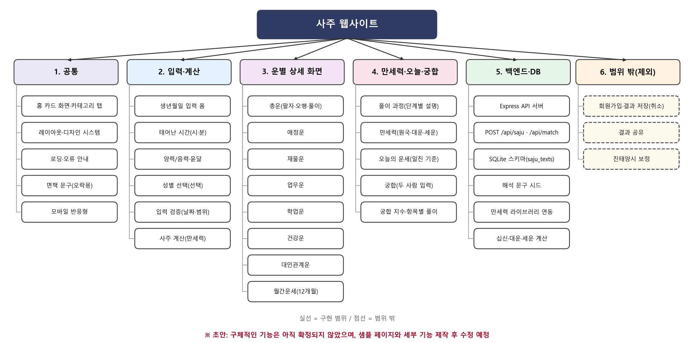
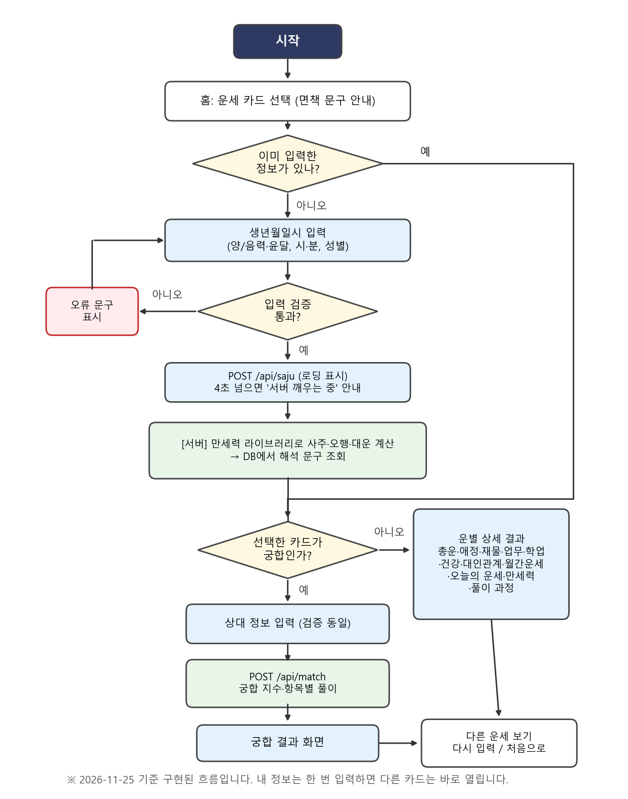
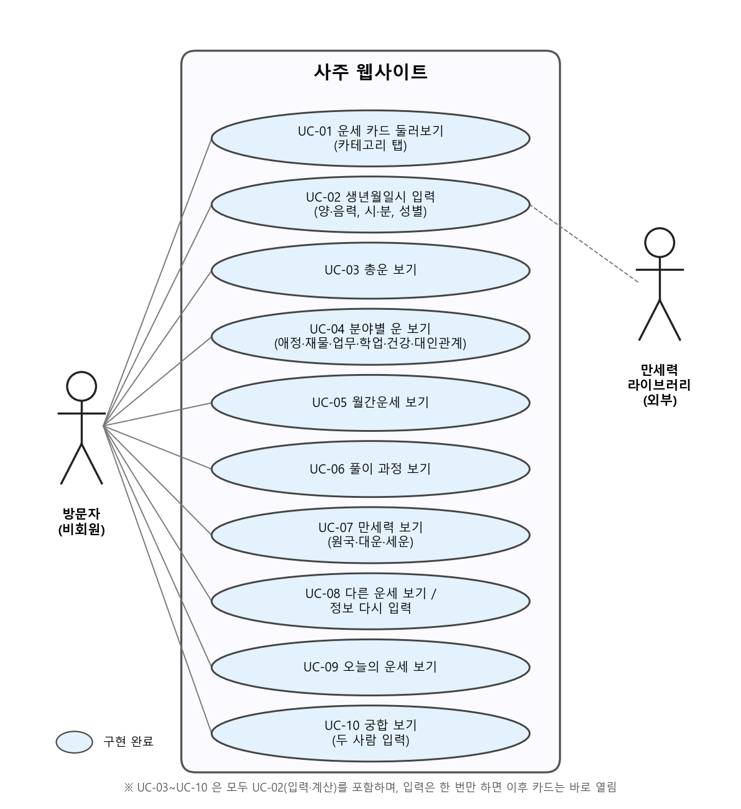

# 사주 웹사이트 (고급 웹 프로그래밍 팀 PBL)

생년월일시만 입력하면 가입 없이 무료로 사주 팔자와 운세를 볼 수 있는 웹사이트입니다.
팀: 김한서, 최서혁, 민준형 / 활동 기간: 2026-10-21 ~ 2026-11-25

- 배포 주소: https://saju-fortune-etn5.onrender.com
  (Render 무료 플랜이라 한동안 접속이 없으면 잠들어 첫 접속이 30~60초 걸릴 수 있습니다.)
- 서비스는 오락·참고용이며, 입력한 정보는 서버에 저장하지 않습니다.

## 어떤 서비스인가요
기존 사주 사이트(명운소·점신·혜안·포스텔러)를 조사해 보니 첫 화면 선택지가 많고, 가입·결제·앱 설치로 이어지는 경우가 많았습니다.
이 프로젝트는 **가입 없이, 무료로, 소수의 기능에 집중**하고 **풀이가 어떻게 나왔는지 과정을 보여 주는 것**을 차별점으로 삼았습니다.
조사 결과는 [레퍼런스_사이트_비교표.md](레퍼런스_사이트_비교표.md)에 있습니다.

## 주요 기능
홈에서 운세 카드를 고르면 생년월일시를 입력(한 번만)하고, 고른 운의 상세 화면만 보여 줍니다.

| 카드 | 내용 |
|---|---|
| 정통사주 총운 | 사주 팔자 표, 오행 분포, 일간·강한/부족한 오행·일지 풀이 |
| 애정·재물·업무·학업·건강·대인관계 | 핵심 풀이, 강한 오행에 따른 풀이, 타고난 성향, 올해·이번 달 흐름 |
| 월간운세 | 앞으로 12개월의 흐름 |
| 오늘의 운세 | 오늘의 일진과 내 일간의 관계로 총평과 분야별 한 줄 |
| 궁합 | 두 사람 입력 → 일간·일지·오행·십신 관계로 궁합 지수와 항목별 풀이 |
| 만세력 | 원국(십신·공망), 대운(성별 입력 시), 올해부터 10년 세운 |
| 풀이 과정 | 입력 → 양력·음력 환산 → 년·월·일·시주 → 오행 집계 → 풀이 연결을 단계별로 설명 |

입력은 양력/음력(윤달 포함), 시·분(시간을 모르면 생략), 성별(선택)을 지원합니다.


## 기술 스택
| 영역 | 사용 기술 |
|---|---|
| 프론트엔드 | React 19, Vite 8 |
| 백엔드 | Node.js, Express 5 |
| DB | SQLite (Node 내장 `node:sqlite`) — 해석 문구 저장 |
| 사주 계산 | 오픈소스 만세력 라이브러리 [`manseryeok`](https://www.npmjs.com/package/manseryeok) (MIT) |
| 배포 | Render (`render.yaml`), 서버 하나가 빌드된 화면과 API를 함께 제공 |

### 동작 방식
```
[브라우저: React] --fetch(JSON)--> [Express API] --> 만세력 라이브러리(사주 계산)
                                        └--> SQLite(해석 문구 조회)
```
- 해석은 **규칙/DB 기반**입니다. 사주·십신·오행 관계를 계산하고, 그 결과에 맞는 문구를 DB에서 골라 보여 줍니다. AI가 문장을 만들지 않습니다.
- 계산과 문구 조합은 서버가 맡고, 화면은 결과 표시만 합니다.
- 입력과 결과는 브라우저 메모리에만 있고 서버에 저장되지 않습니다. 회원가입·로그인은 없습니다.

## 폴더 구조
```
.
├─ saju-tarot/            # 서비스 소스 (폴더 이름은 초기 기획의 흔적이며 타로 기능은 없음)
│  ├─ client/             # React 화면 (pages, components, 카드 이미지)
│  ├─ server/             # Express API, 계산 로직(services), SQLite·문구 데이터
│  └─ docs/               # 구조도, 유스케이스 다이어그램 등 이미지
├─ render.yaml            # Render 배포 설정
├─ 프로젝트_구조_설계.md     # 기술 스택, API, DB, 화면 구성
├─ 유스케이스_명세.md       # 유스케이스 목록·상태·명세
├─ 검증표_사주계산.md       # 계산 테스트·검증 방법
├─ 레퍼런스_사이트_비교표.md  # 기존 사이트 조사
├─ PBL_3·4·5주차진행보고서.docx
└─ react_course_analysis.md # 수업(React) 개념 분석 메모
```

## 실행 방법 (Node.js 22.13 이상)
```bash
# 1) 서버 (http://localhost:3000)
cd saju-tarot/server
npm install
npm run seed      # 해석 문구를 SQLite에 넣기
npm run dev

# 2) 클라이언트 (http://localhost:5173, /api는 3000으로 프록시)
cd saju-tarot/client
npm install
npm run dev
```
계산 테스트는 `cd saju-tarot/server && npm test`로 실행합니다(18개 항목, 결과와 방법은 [검증표_사주계산.md](검증표_사주계산.md)).
배포용 실행과 Render 배포 방법은 [saju-tarot/README.md](saju-tarot/README.md)에 있습니다.

## 설계 문서
- [프로젝트_구조_설계.md](프로젝트_구조_설계.md): 기술 스택, API 명세, DB, 화면 구성
- [유스케이스_명세.md](유스케이스_명세.md): 유스케이스 10개의 상태와 명세
- [검증표_사주계산.md](검증표_사주계산.md): 사주 계산 자동 테스트와 검증 방법·한계





## 알려진 한계
- 해석·궁합·오늘의 운세 문구는 모두 **초안**이며 명리 전문가의 검수를 받지 않았습니다. 오락·참고용입니다.
- 사주 계산은 라이브러리 결과를 그대로 사용했고, 자동 테스트(일주·시주 3,775건, 입춘 시각, 음력 환산 등)로 검증했지만 외부 만세력 앱과의 1:1 대조는 하지 않았습니다. 자시(23시대) 출생의 일 경계는 라이브러리 기본 기준을 따르며 진태양시 보정은 적용하지 않았습니다.
- 궁합 지수는 팀이 정한 규칙(일간·일지·오행·십신 각 항목 최대 25점)으로 계산한 재미용 지표입니다.
- 사이트의 일러스트는 팀이 준비한 이미지를 잘라 사용했습니다. 이미지의 사용 조건은 제출 전에 확인해야 합니다.
- Render 무료 플랜은 서버 파일이 초기화되므로 결과를 저장하는 기능을 넣으려면 외부 DB가 필요합니다.
- 회원가입·결과 저장, 결과 공유, 진태양시 보정은 범위에서 제외했습니다.

## 라이선스
GNU GPL v3 ([LICENSE](LICENSE)). 사주 계산에 사용한 `manseryeok`는 MIT 라이선스입니다.
